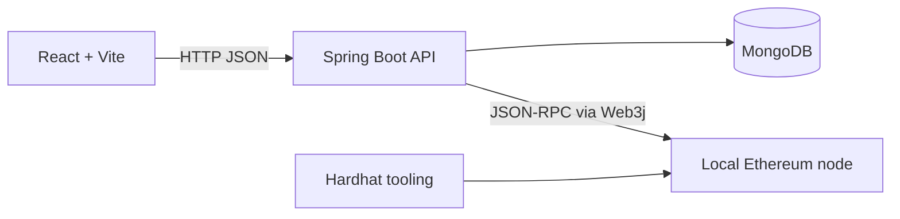

# Architecture — Phase 1

The API owns server-side connectivity checks. The browser displays returned status and does not infer service health locally. MongoDB is intended to be the application data store. Ethereum is the external verifiable state layer. Authentication and identity flows are future phases.

## Phase 4 — on-chain identity registry

MongoDB remains the source of truth for application accounts and wallet links. The Solidity `IdentityRegistry` stores only wallet address, active state, application role and registration timestamp. Spring Boot uses Web3j to query the configured contract and submit manager-authorized transactions. A ChainAuth application ADMIN is required for the admin API, and the address must already be linked in MongoDB before a write is attempted. Ethereum transactions are not atomic with MongoDB; durable synchronization and retry handling are Phase 5 work.

**Phase 4 authorization boundary:** on-chain role records are not yet used as Spring Security authorities. The ChainAuth MongoDB role remains authoritative for API access until Phase 5 implements a confirmation-aware synchronization policy.
